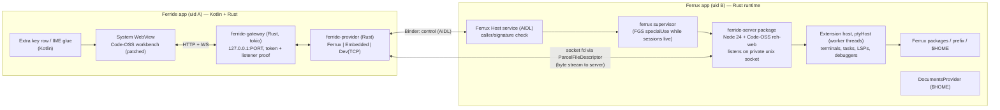

# Ferride: technical research

> ## Decision update (2026-11-07): own editor
>
> **The recommendation in §8 (approach A′: real Code-OSS in a WebView with the Node server inside Ferrux) is superseded.** The founder chose **approach B, a native editor of our own**: a **Rust core** (rope buffer, tree-sitter, LSP client, workspace/search, later git) with a **Kotlin + Jetpack Compose UI**, which is the FerraStack-wide stack (Ferrux, Lomio).
>
> **UX goal:** our own engine, but it should *look and feel* like VS Code / VSCodium adapted for phones (Activity Bar, Side Bar, tabs, Panel, Status Bar, Command Palette, VS Code command ids, keybindings, `settings.json` keys, and VS Code color themes), so VS Code users feel at home.
>
> Why:
> - **Phone/touch-first UX.** VS Code's workbench isn't touch-native and upstream won't make it so (§2.1). Owning the UI lets us design for portrait phones, thumbs and soft keyboards instead of patching around them.
> - **Lightweight.** Tens of MB installed and ~50–150 MB RAM, instead of ~800 MB on disk and 400–700 MB RAM for a VS Code server + WebView (§1.1, §3).
> - **No upstream patch treadmill.** VS Code now ships weekly (§3 A); a native editor has no 43-patch rebase every few weeks.
> - **Real Rust value.** The core (buffer, parsing, search, LSP plumbing, git) is exactly where Rust is strong, and it's shared knowledge with Ferrux.
> - **Clear differentiation.** VSCodroid already ships real VS Code on Android (§1). Ferride doesn't compete on that; it's a small, native, phone-first editor that shares one Linux environment with Ferrux.
>
> What changes versus this document:
> - **The IME blocker in §2.4 doesn't apply**: it concerns *Rust GUI toolkits*. Ferride's UI is Kotlin; the editor surface is a custom Android `View` with its own `InputConnection` (the sora-editor / Squircle approach), so the platform IME works natively.
> - **VS Code extensions are out.** Language smarts come from **LSP servers running inside Ferrux**, reached through the Ferrux Host API.
> - **Still valid:** Android exec restrictions (§4.2), cross-app integration via a **signature-protected AIDL bound service with fd passing** (§5, §10, minus the Code-OSS-specific parts such as `ferride-server` and `connect("unix:ferride-server")`), the phantom-process budget, 16 KB pages, Play policy, developer verification, and most risks in §7 (minus the upstream-tracking and VS Code touch risks; plus the cost of building editor features ourselves).
>
> The new architecture and milestones are in [`ARCHITECTURE.md`](ARCHITECTURE.md). The rest of this document is kept unchanged for history.


**Status:** research and decision input, not a spec.
**Date:** 2026-11-07
**Scope:** how to build "VS Code on your phone" for Android, where Rust fits and where it doesn't, and how Ferride should sit on top of **Ferrux** (FerraStack's Rust Termux alternative).

> **Short version.** Running *real* VS Code on Android has been done, and done well: VSCodroid (MIT, Kotlin) ships Code-OSS 1.139.1 in a WebView with a bundled Node server, on Google Play. The hard problems are not the editor. They are the Android runtime: exec restrictions, phantom-process limits, Termux-built binaries with hardcoded paths, the IME, storage, and staying current with an upstream that now **ships every week**. Rust can't make the VS Code UI or the extension host better. It can make the runtime underneath better, and that runtime is the part Ferrux is building anyway. So the recommendation: **Ferride is a thin, polished VS Code client (Kotlin shell, WebView, Rust gateway). The Code-OSS server runs *inside Ferrux's* Linux environment, reached through a small, versioned Ferrux Host API.** A native Rust editor is not worth building now.

---

## Table of contents

1. [VSCodroid deep dive](#1-vscodroid-deep-dive)
2. [Prior art](#2-prior-art)
3. [Approach options and honest comparison](#3-approach-options-and-honest-comparison)
4. [Where Node.js comes from, exec restrictions, Play Store](#4-where-nodejs-comes-from-exec-restrictions-play-store)
5. [Sharing a Linux environment between two Android apps](#5-sharing-a-linux-environment-between-two-android-apps)
6. [Does Rust make sense? Layer by layer](#6-does-rust-make-sense-layer-by-layer)
7. [Risks](#7-risks)
8. [Recommendation](#8-recommendation)
9. [Proposed architecture](#9-proposed-architecture)
10. [Ferrux integration contract](#10-ferrux-integration-contract)
11. [MVP milestones](#11-mvp-milestones)
12. [Sources](#12-sources)

---

## 1. VSCodroid deep dive

Read from a shallow clone of `rmyndharis/VSCodroid` at `c5aba45` (2026-11-07) plus its GitHub issues and releases.

### 1.1 Facts at a glance

| Item | Value |
|---|---|
| License | MIT (own code); bundled components carry their own (Code-OSS MIT, Node MIT, GPL tools from Termux, etc.) |
| Started / 1.0 | repo created 2026-02-11; v1.0.0 on 2026-04-21; v1.7.0 on 2026-11-07 |
| Popularity | ~316 stars, 63 forks, on Google Play (`com.vscodroid`) |
| VS Code version | Code-OSS **1.139.1** (pinned by commit, `VSCODE_COMMIT`), upstream is already at 1.145.2 |
| Android | minSdk 30 (Android 11), targetSdk 36, arm64-v8a only, WebView ≥ Chrome 125 |
| Code size | ~50k lines of Kotlin in `main/` (+ ~119k lines of tests), 43 Code-OSS patches, ~2.7k lines of JS bootstrap, 5 C shims |
| Release APK | 206 MB APK / 356 MB AAB; ~603 MB extracted; ~800 MB free space to install; 400–700 MB RAM typical |
| Toolchains | Ruby / Java 21 / C++ as Play Asset Delivery on-demand packs (10 / 60 / 75 MB zips), GitHub-release zips for sideloads |

The largest Kotlin files tell you where the effort went: `MainActivity.kt` (8.4k lines), `SafSyncEngine.kt` (7.5k), `FirstRunSetup.kt` (6.7k), `ToolchainManager.kt` (5.4k), `VSCodroidWebViewClient.kt` (2.8k), `ProcessManager.kt` (2.4k), `NodeService.kt` (1.7k), `AndroidBridge.kt` (1.6k), `KeyInjector.kt` (1.1k). That is storage mirroring, asset extraction, toolchain install, WebView plumbing, process supervision and keyboard handling. Almost none of it is "the editor."

### 1.2 How it runs VS Code

- **Not code-server, not openvscode-server.** It builds **Code-OSS from the MIT `microsoft/vscode` source** with its own diffs, using the `vscode-reh-web-linux-arm64` gulp target. That target produces a "remote extension host" server that also serves the web workbench. The build runs on an **arm64 runner**, because native modules get built for the host and an x86-64 tree builds green and then fails at exec on the device. One build is published per VS Code version as a `server-<version>` GitHub release (`vscode-reh-web-linux-arm64-1.139.1.tar.gz`, 121 MB), and the app build fetches it.
- **The UI** is the VS Code web workbench (`vscode-web`) in the **system Android WebView**, not a bundled Chromium (that would add more than 100 MB). It needs WebView 125 or later because the workbench positions webviews with CSS anchor positioning.
- **The server** is `libnode.so` (Node **24.18.0**, taken from **Termux's `nodejs-lts`** .deb at build time) running `server.js`, which launches `vscode-reh`. Node is a separate process, started by Kotlin `ProcessBuilder` and kept alive by a **foreground service of type `specialUse`**.
- **Transport:** a Kotlin `EditorGateway` owns `127.0.0.1:PORT` for the lifetime of the app process and relays HTTP and WebSocket bytes, unparsed, to the Node server over a **private filesystem (AF_UNIX) socket**. Readiness is `GET /version` plus an HMAC "listener proof" (patch 0039), because loopback is shared by every app on the device and the port alone proves nothing. The server also requires a connection token.
- **Phantom processes:** patches **0003/0004 move the Pty Host and the Extension Host from `child_process.fork()` into `worker_threads`.** That saves two of Android 12+'s 32 system-wide "phantom process" slots. It has costs: an extension-host crash can take the server down, and a worker can't receive a socket handle, so the host reconnects over a named pipe. 0004 also had to add a reconnect handshake, because otherwise every dropped WebSocket silently killed every extension.
- **Platform identity:** Termux Node reports `process.platform === "android"`, and VS Code only checks for `"linux"`. Patches 0001/0002 treat Android as Linux. `platform-fix.js` (`NODE_OPTIONS=--require`) selectively fakes `linux` for npm/node-gyp but not for Rollup or esbuild, which ship real `android-arm64` builds.

### 1.3 How it gets around exec restrictions

This is the single biggest source of complexity in the whole project. It is documented in `docs/04-TECHNICAL_SPEC.md` §2.3 and in the C shims.

1. **Bundled executables ship as `lib*.so` in `jniLibs/arm64-v8a`** with `useLegacyPackaging = true`, so the package manager extracts them into `nativeLibraryDir`, which is executable: `libnode.so`, `libbash.so`, `libgit.so`, `libripgrep.so`, `libssh.so`, `libtmux.so`, `libmake.so`, `libpython.so`, `libldmusl.so`, `libexec-trampoline.so`, …
2. **Native Node addons** (`pty.node`, `watcher.node`, `vscode-sqlite3.node`, `zeromq.node`) stay under `filesDir`, because SELinux denies `execve` on `app_data_file` but **still allows `dlopen`/mmap-exec**.
3. **Anything installed at run time** (toolchains, `pip`/`gem` console scripts, user-built binaries) can't be `execve`d. VSCodroid layers several workarounds:
   - bash **functions** (`npm`, `npx`, toolchain commands) in `.bashrc` and in a `BASH_ENV` file;
   - `libexec-trampoline.so`: a C program reached through per-command symlinks in `usr/libexec/tcbin` (ahead on `PATH`). It dispatches on `argv[0]` through a TSV table and runs the payload as `/system/bin/linker64 <payload>`;
   - **termux-exec** (`LD_PRELOAD`), built from source with a patch, applied **only to terminals and tasks** through `terminal.integrated.env.linux`. It rewrites every `exec*` of a file under the data dir into `linker64 <path>`. A dangling `LD_PRELOAD` aborts every exec, so the path has to be a real file under `filesDir`;
   - shebang scripts can't be exec'd directly, so the generator rewrites interpreter rows; git's `askpass.sh` has to go through the trampoline (issue #570, fixed in 1.5.0).
   
   What still doesn't work: a process an *extension* spawns by absolute path under `filesDir` (no preload there), and anything that forks a helper by absolute path (the JDK's `jspawnhelper`).
4. **glibc and musl binaries:** Open VSX extensions that ship CLIs are served the **alpine (musl)** build (patch 0009) and run through a bundled musl loader. glibc builds die with SIGSYS before `main()`, because the app seccomp filter rejects `set_robust_list`/`rseq`. musl has no `/etc/resolv.conf` on Android, so `dns-proxy.js` provides an HTTP(S) proxy in Node, whose Bionic DNS works. `seccomp-shim.c` emulates `epoll_pwait2` on Android 13/14 by catching SIGSYS. `glibc-shim.c` gives prebuilt glibc addons the few glibc-only symbols they import.
5. **Termux binaries carry Termux's prefix** (`/data/data/com.termux/files/usr`) compiled in. VSCodroid patches Node's default shell, sets `OPENSSL_CONF`, `GIT_EXEC_PATH`, `TERMINFO`, etc., and still ships bugs like issue **#595, "Bundled SSH has hardcoded termux paths"** (`known_hosts` written to `/data/data/com.termux/...`, fixed in 1.7.0).

**Lesson for FerraStack:** a Linux-on-Android environment that is *built for its own prefix* and *solves exec once, for everyone* (which is Ferrux's whole job) removes most of VSCodroid's accidental complexity from the editor.

### 1.4 Extensions

- **Open VSX** instead of the Microsoft Marketplace, because the Marketplace terms limit use to Microsoft's own products. This is set in `product.json`'s `extensionsGallery`. Microsoft-only extensions (Pylance, C# Dev Kit, Remote-SSH, Live Share) aren't available.
- Extensions run in the Node extension host (worker thread). Platform-specific VSIXs are requested for the `alpine-arm64` target.
- Some extensions are pre-bundled, plus VSCodroid's own helpers (a welcome extension, `saf-bridge`). Extensions reach the Android side only through a fixed command list over a BroadcastChannel relay. The `@JavascriptInterface` object is injected only into the trusted workbench context.
- Open VSX started rate limiting in 2026 (individual clients: about 3 req/s or 10,800/h sustained), and the Eclipse Foundation launched a paid "Managed Registry" in April 2026. A popular app should cache metadata and send a client identifier.

### 1.5 Terminal

The VS Code integrated terminal (xterm.js in the WebView) talks to **node-pty** in the Pty Host worker, which spawns **bash on a real `/dev/pts` PTY**, one bash per tab. There is no separate terminal app or emulator. tmux is bundled for users who want persistent sessions. Each bash process counts against the phantom-process budget.

### 1.6 File system access

- The default workspace is `filesDir/projects`, which is app-private. Shared storage over FUSE doesn't support `symlink(2)`, so `npm install` broke there.
- Other device folders come in through the **SAF folder picker**. Because the server only understands POSIX paths, VSCodroid keeps a **local mirror with write-back** (`SafSyncEngine`, 7.5k lines). **`.git` is excluded**, so a repository opened from shared storage has no git history in the editor.
- No `MANAGE_EXTERNAL_STORAGE` (Play restricts it), so users who want *one git working tree shared with Termux/Obsidian* can't have it (issue **#572**).

### 1.7 Keyboard and touch

- A native **Extra Key Row** (Ctrl/Alt/Tab/Esc/F1–F12/symbols, a trackpad for the cursor, a quick-action page) sits under the WebView.
- `KeyInjector` uses three routes: printable characters become real Android `KeyEvent`s via `KeyCharacterMap.VIRTUAL_KEYBOARD` (a synthetic DOM `KeyboardEvent` is untrusted and inserts nothing); navigation keys become real key pairs with scan codes; command keys and chords are "announced" as DOM events through `evaluateJavascript`. Latched modifiers, spatial navigation in WebView and Chromium-version quirks (Alt+Left before Chromium 149) each need their own handling.
- **IME:** VS Code's editor uses the **EditContext** API. Six patches (0022–0025, 0028, 0029) keep the IME buffer and caret in sync, keep the suggest widget in step with compositions, and turn long commits into one paste. Soft keyboards on Android WebView are clearly the hardest UX problem.
- Further patches cover menus, sashes, the activity bar, settings and panel layout at phone width (0008, 0014–0017, 0030–0034, 0041), and a UI scale command.
- Hardware keyboards: the key row hides itself after a physical keystroke (issue #512).

### 1.8 Known issues and pain points (issues, README, risk matrix)

- VSCodroid's own risk register scores **phantom-process killing as critical (20/25)**, **monthly (now weekly) VS Code updates breaking patches 16/25**, **Play rejection over binary execution 15/25**, and **the Node ARM64 build 15/25**.
- Portrait-layout complaints (#594), hardcoded Termux paths (#595), exec permission bugs (#570), and shared-storage and Termux interop (#572).
- Memory: only the V8 heap is bounded (256–768 MB, derived from device RAM). Language servers are never killed, because killed ones are restarted within a second by their extensions.
- Weight: about 800 MB on disk before the user writes a line of code.

### 1.9 What Ferride can reuse

VSCodroid is MIT and Ferride is Apache-2.0. MIT code can be incorporated into an Apache-2.0 project as long as the MIT notice is kept (in `NOTICE` and the file headers). Reusable directly, with attribution: the **patch set** (especially 0001–0004 platform and worker threads, 0009 alpine target, 0022–0029 IME/EditContext, the layout patches), `server.js`, `platform-fix.js`, and the key-injection design. Ferride should **not** reuse the Termux-binary-repackaging pipeline; that job belongs to Ferrux.

> **Strategic note (honest):** VSCodroid already *is* "VS Code on your phone", MIT-licensed and on Play. If Ferride just rebuilds it in another language, the result is a weaker clone. Ferride is only worth building if its differentiator is real: **one shared Linux environment with Ferrux** (same files, same packages, same git tree, same terminal sessions), a much smaller app, and a runtime that solves exec and packaging once, in Rust. Talking to VSCodroid's maintainer about sharing patches is worthwhile either way.

---

## 2. Prior art

Numbers come from `gh api` and crates.io on 2026-11-07.

### 2.1 VS Code on Android, other routes

| Project | What / stack | Status | Lesson |
|---|---|---|---|
| **code-server in Termux** (`pkg install tur-repo code-server`) | Coder's VS Code-in-browser (MIT, ~80k★), opened in Chrome at `localhost:8080` | **v4.145.2, released 2026-11-07, tracks Code 1.145.2 within a day.** The TUR package pins `nodejs-24` and strips `--max-old-space-size` | Known breakages: Android counts as an unsupported platform, so only web extensions install unless you spoof `process.platform`; git fails in `/sdcard`; Tab needs `keyboard.dispatch: keyCode`; old argon2/ripgrep "unknown platform android" bugs; the soft keyboard doesn't open in mobile browsers (#7926, closed as "core VS Code"). **It's a good M0 stand-in backend for Ferride.** |
| **openvscode-server** (Gitpod) | Upstream VS Code server, MIT | **Lagging:** last release v1.109.5 (2026-02-20) while upstream is at 1.145. Runs on Android only inside proot-distro | Don't base Ferride on it. Build Code-OSS directly (as VSCodroid does) or follow code-server. |
| **VHEditor** | code-server + embedded Termux in a WebView | v2.21.0 (2025-12) | Same idea as VSCodroid, less polished. |
| **Code FA** (Flutter) | code-server in an Ubuntu proot + WebView | v1.6.1 (2025-08), slow maintenance | proot works but is heavy. |
| **Code on the Go** (successor to AndroidIDE, which was archived in 2024) | Java/Kotlin, sora-editor, vendored Termux terminal + bootstrap, targetSdk 28 | Weekly releases (26.45, 2026-11-03) | Embedding Termux works if you give up Play. |
| **CodeAssist** (revived) | Compose UI, JDT/Kotlin analysis, LSP-as-plugins (gopls, rust-analyzer, pyright, clangd) | v3.42.0 today, near-daily releases | Native UI + LSP plugins is viable without VS Code. |
| **vscode.dev / github.dev** on a phone | Microsoft's web VS Code | Microsoft never committed to mobile (#136762). Open upstream issues: the keyboard overlaps the UI (#305591), long-press menus flash closed on Android Chromium (#336557) | **Upstream VS Code isn't touch-friendly, and won't be.** Ferride will carry mobile patches indefinitely. |

### 2.2 Non-VS Code Android editors

- **Acode** (MIT, 7.7k★, v1.13.5, nightlies daily). Cordova + **CodeMirror 6** (it migrated off Ace in Feb 2026, PR #1879), a built-in **LSP client** (`@codemirror/lsp-client`, multi-server), and a built-in **terminal**: xterm.js + proot + Alpine, with **`axs`, a Rust PTY-over-WebSocket server** (axum + `portable-pty`). JS plugin registry. It disabled CodeMirror's `EditContext` on Android because of Chromium scroll jumps (#2258) and added an experimental canvas renderer (#2988, Oct 2026), so DOM editors on phones still struggle.
- **Spck Editor**: proprietary (Android/iOS/web), git client, Node runner in Pro.
- **Squircle CE** (Apache-2.0, 1.9k★): Kotlin/Compose on a sora-editor fork, terminal + git modules, no LSP. Slowing down (last release 2025-05).
- **Xed-Editor** (GPL-3, 2.4k★): sora-editor, LSP, terminal with an Ubuntu rootfs, extensions. **Its Play build drops the extension store**, a policy lesson.
- **sora-editor** (LGPL-2.1): the de-facto native Android code-editor view (TextMate + tree-sitter + LSP).
- **iOS Code App**: dropped Monaco for a native editor (Runestone) because of touch problems (#1002).
- **Termux** ships neovim 0.12.6, helix 25.07.1, kakoune, micro, emacs 31.1. A modal TUI in a good terminal is still the lightest "IDE" on a phone.

### 2.3 Rust editors

| Project | License | UI | Plugins | Android |
|---|---|---|---|---|
| **Lapce** | Apache-2.0 | floem + wgpu | WASI | **None.** floem's Android request has been open since 2024 (#619). v0.4.6 (2026-01), 39k★ |
| **Zed** | GPL-3 app / Apache gpui | gpui (GPU) | WASM extensions | **None official.** Zed 1.0 shipped 2026-04-29 (macOS/Linux/Windows); now 1.27/1.28-pre. Third-party **gpui-mobile** (AGPL-3, 489★) implements an Android platform with a custom `InputConnection` |
| **Helix** | MPL-2.0 | TUI | Steel PR open since 2023 | Works in Termux. No release since 25.07.1. `helix-core`/`helix-lsp` aren't published crates (0.0.0 placeholders) |
| **xi-editor** | Apache-2.0 | n/a | n/a | Discontinued. `xi-rope` lives on as `lapce-xi-rope` |
| **Makepad** | MIT/Apache | own GPU renderer (GLES on Android) | n/a | **Real Android support** with its own `MakepadInputConnection` (Feb–Jun 2026), and a `code_editor` crate. But `main` is in flux (now agent-focused) and there's been no crates.io release since 1.0.0 (2025-05) |

No open-source Rust-GUI *code editor* ships as an Android APK today.

### 2.4 Rust GUI on Android: the IME problem

A code editor lives or dies by the soft keyboard (composition, autocorrect, swipe typing, selection handles, CJK). In Nov 2026:
- **winit:** soft-keyboard support issue #1823 has been open since **2021**, and the Android IME PRs (#4451, #4736, #4801) are still open. **egui, Xilem and Bevy** inherit this gap (egui #5590 "keyboard not opening under Android" is open).
- **android-activity 0.6.1:** `show_soft_input` and `set_ime_editor_info` are merged, GameTextInput null-buffer crashes are open.
- **Slint 1.18:** the most mature. It ships a real Java `BaseInputConnection` (editable, composing spans, CursorAnchorInfo, selection handles), but has had per-OEM regressions (Motorola #11344) and is GPLv3 or commercial.
- **Makepad:** its own InputConnection since 2026. **Dioxus/Blitz:** Vello black screen on Android, keyboard state lost after resume. **floem:** no Android.
- **Tauri v2** (2.12.5): WebView-based, so the system IME works as well as Chrome's does.

**Verdict:** a native Rust editor UI on Android in 2026 means writing and maintaining your own Java `InputConnection` shim and fighting per-OEM keyboard bugs. The WebView is still the pragmatic text-input surface, even with VS Code's EditContext quirks (VSCodroid patches 0022–0029; Acode turned EditContext off).

### 2.5 Rust building blocks (for the runtime, Lite mode, or a future native editor)

| Need | Crate (version) | Notes |
|---|---|---|
| Rope | `ropey` 1.6.1 / 2.0-beta, `crop` 0.4.3, `lapce-xi-rope` 0.4.0 | pure Rust |
| Parsing | `tree-sitter` 0.27.2 | C core builds with the NDK. Compile grammars in; don't download `.so` files |
| LSP | `async-lsp` 0.2.4, `lsp-server` 0.10, `tower-lsp-server` 0.23 + `ls-types` | `lsp-types` 0.97 is stale; `tower-lsp` is dead |
| Terminal | `alacritty_terminal` 0.26, `vte` 0.15, `termwiz` 0.23 | used by Zed and Lapce |
| PTY | `portable-pty` 0.9 (works on aarch64-android, as Acode's `axs` shows), or raw `openpty` via `nix`/`rustix` | the spawned program must be exec-able (§4) |
| Search | `grep-searcher` 0.1.17, `ignore` 0.4.34 (ripgrep 15.2) | VS Code search already uses ripgrep |
| Watch | `notify` 8.2.1 | inotify backend on Android; unreliable on FUSE shared storage |
| Git | `gix` 0.90 (use the `ring`/rustls backend; aws-lc-rs is harder with the NDK), `git2` 0.21 (vendored OpenSSL/libssh2) | |
| Kotlin bindings | `uniffi` (Mozilla, active), `jni` 0.22, `cargo-ndk` 4.1 | standard Rust-on-Android plumbing |
| Reference code | **`microsoft/vscode/cli`** (Rust, MIT): `code serve-web`, tunnels, a "server of servers" HTTP/WS proxy with connection-token and secret-key minting | the closest prior art for a Rust VS Code gateway |

---

## 3. Approach options and honest comparison

### (A) VSCodroid-style: real VS Code (web workbench in WebView) + bundled Node server

Code-OSS `reh-web` server on Node, workbench in the system WebView, and everything (Node, git, bash, toolchains) bundled in the APK. Rust only for glue: the gateway/supervisor, an exec trampoline, maybe the PTY.

- **Extension compatibility:** maximum available off Microsoft's marketplace. Every Open VSX extension whose native parts run on Android (musl/alpine builds, pure JS, WASM) works, plus debuggers, tasks and the git SCM.
- **Effort:** medium to high, but *proven*. VSCodroid went from repo creation to Play 1.0 in about 10 weeks and has iterated for 7 months since. Ferride could start from its patches.
- **Phone performance:** acceptable on 6 GB+ devices. 400–700 MB RAM, a cold start of several seconds, and the WebView renderer and Node heap compete for memory.
- **APK size:** about 200 MB APK / 350 MB AAB, about 800 MB installed.
- **Upstream tracking:** heavy. VS Code moved to **weekly** releases (1.139.1 on 2026-09-25 → 1.145.2 on 2026-11-06, seven minor versions in six weeks). Each bump means rebasing the patch set, rebuilding on an arm64 runner, re-checking `remote/.npmrc`'s Node target, rebuilding node-pty/parcel-watcher/sqlite3 for Android, and re-testing the IME. In practice you pin and bump every 4–8 weeks.
- **Rust value:** small. Ripgrep is already Rust, and node-pty and parcel-watcher are already native. Rust would replace about 2–3k lines of Kotlin gateway and supervisor code and a few hundred lines of C shims. It doesn't touch the 43 TypeScript patches, the 50k lines of Kotlin Android glue, or Node.
- **Ferrux fit:** weak if done literally. Ferride would ship its *own* second Linux environment next to Ferrux's (two Node copies, two git copies, two home dirs, VSCodroid's #572 problem all over again).

### (A′) Variant: same editor stack, but the server runs **inside Ferrux**

Same as A for the user-visible editor, but the Code-OSS server, Node, git, shells and toolchains are **Ferrux packages running in Ferrux's sandbox**. Ferride is a thin client: Kotlin shell, WebView, key row, IME patches, and a Rust gateway that reaches the server through the Ferrux Host API (§10).

- **Extension compatibility:** the same as A, and better over time because extensions can use *any* Ferrux package (clangd, rust-analyzer, gopls, python, …) without Ferride shipping them.
- **Effort:** similar to A for the editor; the runtime work moves to Ferrux, which has to do it anyway. A new piece of work: the Host API and pairing UX.
- **Performance:** the same as A. Cross-app relaying adds microseconds per message, which doesn't matter here.
- **APK size:** Ferride itself is **about 10–20 MB**. The server package (about 120 MB unpacked for Code-OSS reh-web, plus about 60 MB for Node and ICU) is downloaded once inside Ferrux.
- **Upstream tracking:** the same patch burden as A, but the *server* ships as a Ferrux package, so it can update without a Play release. The workbench JS is served by the server and comes along with it.
- **UX cost:** two apps to install. That needs a first-run "Install Ferrux" flow and pairing. Mitigations are in §5 and §10. Advantage: Ferride on Play is a pure client, which avoids most of the executable-code policy questions; those move to Ferrux.

### (B) Native Rust editor (Lapce/floem, Zed/gpui, Helix core, ropey, tree-sitter, LSP)

- **Extension compatibility:** **none** with VS Code. You get LSP (language servers would run inside Ferrux), tree-sitter grammars and maybe a WASM plugin system (like Zed's). Debuggers via DAP are possible but it's all new work.
- **Effort:** very high. Lapce has taken years and is still pre-1.0 (v0.4.6, Jan 2026, with no Android support). Zed reached 1.x with a large paid team and doesn't target Android. On Android you'd also be building your own **soft-keyboard IME integration, touch selection handles, accessibility and text shaping**. Those are exactly the areas where Rust GUI toolkits on Android are weakest (§2).
- **Performance:** potentially the best: native rendering, 50–150 MB RAM, instant start.
- **APK size:** small (10–30 MB).
- **Upstream tracking:** none to VS Code, but you own everything.
- **Verdict:** this is where Rust fits best technically, and it's the worst product bet. "VS Code on your phone" without VS Code extensions isn't the product. Keep it as a *possible long-term R&D track*, for example a native "quick edit" mode built on ropey and tree-sitter. It's not the MVP.

### (C) Hybrid: VS Code workbench in WebView, Rust backend replacing parts of the Node server

There are two very different readings.

**C1: replace the server's internals in Rust (keep the Node extension host).** Not feasible. The workbench talks to `vscode-reh` over VS Code's **internal, undocumented IPC** (a `PersistentProtocol` over WebSocket, with channels such as `remoteFilesystem`, `remoteterminal`/ptyHost, extension-host management, `download`, `logger`, …). It changes without notice, and upstream now ships weekly. Reimplementing part of it in Rust would mean tracking private TypeScript interfaces forever. And the parts worth speeding up are *already native*: search is **ripgrep (Rust)**, file watching is `@parcel/watcher` (C++), terminals are `node-pty` (C++). **Rust gains essentially nothing here.**

**C2: "serverless" web workbench + Rust daemon + web extensions.** Run the workbench like vscode.dev, with only the **web-worker extension host** and no Node. Provide platform services as built-in *web extensions* that talk to a Rust daemon over a WebSocket:
- files via `registerFileSystemProvider`;
- terminals via the `Pseudoterminal` API, bridged to Ferrux PTYs;
- search via the proposed `fileSearchProvider2`/`textSearchProvider2` APIs (built-in extensions can be allowed proposed APIs in `product.json`), backed by the `grep-searcher` and `ignore` crates;
- language servers via `vscode-languageclient/browser` over a WebSocket to native servers running in Ferrux;
- git via a custom `SourceControl` provider backed by `gix`.

This is feasible because it uses **public (or proposed) extension APIs, not internal IPC**, which are far more stable.
- **What breaks:** every extension without a `browser` entry point, which is most language tooling (ESLint, Python, Go, C/C++, Java, rust-analyzer's extension, debuggers), plus the built-in Node-based git, tasks, the debug adapters launched as executables, and anything using `child_process`. Only web extensions, declarative ones (themes, grammars, snippets, keymaps) and WASM ones (via `vscode-wasm`/WASI) remain.
- **Effort:** high. You rebuild git, search, tasks, terminal and LSP plumbing as extensions.
- **Benefits:** no Node process (saves about 150–300 MB RAM and a phantom slot), faster start, smaller footprint, and a natural home for Rust.
- **Verdict:** a credible **"Lite mode"** for 3–4 GB devices or a later experiment. It's not the main product, because it gives up the main selling point. A Node extension host can be added *next to* it later, since the web workbench supports a remote server and a web extension host at the same time, but that means maintaining two code paths.

### Comparison table

| | A: bundled VS Code + Node | A′: VS Code, server in Ferrux | B: native Rust editor | C1: Rust replaces server internals | C2: web-only workbench + Rust daemon |
|---|---|---|---|---|---|
| VS Code extension compat | ★★★★★ (Open VSX, musl/JS) | ★★★★★ (+ any Ferrux package) | ☆ (LSP only) | ★★★★★ in theory | ★★ (web/declarative/WASM only) |
| Effort to MVP | Medium (proven) | Medium (+ Host API) | Very high | High, never-ending | High |
| Phone performance | OK (400–700 MB) | OK (same) | Best | Same as A | Good (no Node) |
| Ferride APK size | ~200 MB | **~10–20 MB** | ~10–30 MB | ~200 MB | ~40–60 MB (workbench) |
| Upstream tracking burden | High (patches, weekly) | High for patches; server updates out-of-band | None (own everything) | Extreme | Medium (public APIs + workbench build) |
| Where Rust helps | Gateway, supervisor, shims | Gateway + **all of the Ferrux runtime** | Everything | Little | Daemon (fs/search/pty/git/LSP bridge) |
| Ferrux synergy | Low (duplicate env) | **High** | Medium (LSPs in Ferrux) | Low | High |

---

## 4. Where Node.js comes from, exec restrictions, Play Store

### 4.1 Node.js options

| Source | Version (Nov 2026) | Form | Runs VS Code server? | Verdict |
|---|---|---|---|---|
| **nodejs-mobile** | v18.20.4 (Oct 2024); Node 22/24 PRs still open, the 16 KB release PR was closed unmerged in Apr 2026 | `libnode.so` *library* loaded into the app process through JNI. One instance per process; its FAQ says `spawn`/`fork` "will run into permission issues" | **No.** VS Code 1.145.2 pins the server to **Node 24.22.1** (`remote/.npmrc`), and `fork()` needs a real `process.execPath` | Unsuitable |
| **Termux `nodejs-lts` / `nodejs`** | 24.22.2 / 26.13.0 (both bumped 2026-11-01) | Real executable built with the NDK, about 35 patches, linked to Termux's libc++, OpenSSL, c-ares, ICU (+32 MB `libicudata`), sqlite and zlib, with `DT_RUNPATH=$PREFIX/lib` | **Yes**, and VSCodroid proves it (`libnode.so` = Termux's `bin/node`) | Works, but the prefix `/data/data/com.termux/files/usr` is compiled into strings (default shell, tmpdir, npm). Repackaging means patching around it (VSCodroid #595) |
| **Build ourselves** (upstream `android-configure`, or Termux's recipe with our own prefix) | any | executable | Yes | Upstream says "**Android is not a supported platform**", with no CI. Termux's maintainer reports about **2 CPU-hours per arch per bump** and patch refreshes every time. **This is Ferrux's job:** build `nodejs-lts` *for Ferrux's prefix* from Termux's recipe (Termux's build system supports `TERMUX_APP__PACKAGE_NAME`) |
| Deno / Bun | Deno 2.9.8 in Termux; Bun has no Android target | | No (VS Code server needs Node's exact ABI for native addons) | Not relevant |
| glibc Node under proot / glibc-runner | | ptrace / loader | Slow; the seccomp filter blocks `rseq`/`set_robust_list` | Fallback only for glibc-only extension binaries |

What the VS Code server needs on top of the runtime (VSCodroid's measured list): patches that treat `android` as Linux; Pty Host and Extension Host as `worker_threads` (phantom budget); `node-pty`, `@parcel/watcher` and `@vscode/sqlite3` cross-compiled with the NDK, `-static-libstdc++ -Wl,-Bsymbolic` (otherwise libc++ ODR crashes against Node's libc++), and 16 KB alignment; platform-specific extensions requested as `alpine-arm64`.

### 4.2 Exec restrictions (the rule and the workarounds)

- **The rule:** apps with targetSdk ≥ 29 run in the `untrusted_app` SELinux domain, and `system/sepolicy` has `neverallow … { app_data_file privapp_data_file }:file execute_no_trans` for every untrusted app *except* `untrusted_app_25`/`_27` (targetSdk ≤ 28). So nothing under `filesDir` can be `execve`d. **`execute` (mmap PROT_EXEC) is still allowed**, so `dlopen` of `.so` files and `.node` addons from `filesDir` works.
- **Workarounds, in order of robustness:**
  1. Ship executables as `lib<name>.so` in `jniLibs/arm64-v8a` with `useLegacyPackaging = true`. They land in `nativeLibraryDir` (label `apk_data_file`, executable by every app domain). This only covers what is *in the APK* (or a split / asset pack installed by Play).
  2. `/system/bin/linker64 <path>`: the system linker (`system_linker_exec`) may be executed and it mmaps the payload. Generalised by **termux-exec** (`LD_PRELOAD` that rewrites `execve`). Limits: no static binaries, raw-syscall exec bypasses it, `/proc/self/exe` is the linker, and the preload must survive into children. This is what Termux's Play build and VSCodroid's terminals use.
  3. **targetSdk 28** (Termux on F-Droid/GitHub). Exec just works, but you **can't publish on Play** (Play requires targetSdk 36 for new apps and updates since 2026-08-31), and you depend on an old-target compatibility path that Google may eventually close.
  4. proot (ptrace). Works for anything, but it's slow (Acode's terminal, Andronix).
- **Android 17 (API 37):** "safer native DCL" requires files loaded through `System.load()` to be read-only. Raw `dlopen` from Node isn't mentioned, but it needs testing. Also `ACCESS_LOCAL_NETWORK` for LAN traffic (loopback is expected to be unaffected, also to test).

**Implication for Ferride:** in the Ferrux-hosted design, Ferride itself never `exec`s anything from storage. Every process runs inside Ferrux, so **Ferrux solves exec once** (target-28 flavour on F-Droid, linker64/termux-exec-style flavour on Play) and Ferride inherits the result.

### 4.3 Other platform constraints

- **16 KB pages:** apps targeting 15+ must support 16 KB pages on 64-bit devices. Play's page now says updates that don't comply can't be released **from 2027-02-01**. This applies to *every* ELF, including executables shipped as `lib*.so` and every Ferrux package. Use NDK r28+ or `-Wl,-z,max-page-size=16384` (Rust: `-C link-arg=-Wl,-z,max-page-size=16384`), and check with `zipalign -c -P 16` plus a `readelf` gate in CI (VSCodroid's `verify-android-elf.py` is a good model).
- **Phantom process killer (Android 12+):** **32 child processes across the whole device**, plus a CPU-hog kill. It can be turned off with `settings put global settings_enable_monitor_phantom_procs false` (12L+) or the Android 14+ developer option "Disable child process restrictions". **Ferride and Ferrux share these 32 slots**, so worker-thread patches and a phantom budget monitor are mandatory.
- **Foreground service:** type **`specialUse`** with a `PROPERTY_SPECIAL_USE_FGS_SUBTYPE` justification (VSCodroid uses "Local development server powering the code editor…"). Avoid `dataSync`, which is time-limited on 15+.
- **Storage:** Play restricts `MANAGE_EXTERNAL_STORAGE` to file managers and similar apps. VSCodroid uses SAF mirroring, which breaks `.git` (#572). F-Droid/GitHub builds of Ferrux can request all-files access. Play builds should expose files through a `DocumentsProvider` and SAF.

### 4.4 Play Store and distribution

- **Device and Network Abuse policy:** no downloading of executable code (dex/JAR/.so) from outside Play. Code in a VM or interpreter is exempt when it has only indirect access to Android APIs ("JavaScript in a webview or browser"). **VS Code extensions (JS) from Open VSX fit the exemption** (VSCodroid ships on Play doing this). **Downloading native packages apt-style is the grey zone.** The official Termux team calls the Termux Play build unofficial and says it "may be taken down".
- **Consequence:** **Ferride (a pure client plus JS) is easy to keep Play-compliant. Ferrux is not.** Plan Ferrux as F-Droid/GitHub first, with a Termux-Play-style variant if that's acceptable. Any Ferride flavour that bundles its own environment has to ship native code only inside the APK or Play asset packs (VSCodroid's approach).
- **Android developer verification:** enforced since **2026-09-30** in BR/ID/SG/TH for certified devices, with a global rollout in 2027. The ADB / "advanced flow" for unregistered apps launched in Aug 2026 (developer mode, a restart, a 24 h wait). F-Droid opposes it and re-signs about 85% of its catalogue. **Action:** register the FerraStack package names and keys early, and publish *reproducible, developer-signed* builds so F-Droid ships our signature.

---

## 5. Sharing a Linux environment between two Android apps

Goal: "Ferride uses Ferrux as a convenient terminal / Linux environment." On Android that is less obvious than it sounds, because every app is its own Linux user with its own SELinux MLS categories.

### 5.1 Mechanisms

| Mechanism | Works across apps? | Verdict |
|---|---|---|
| `android:sharedUserId` | Yes, if both apps have the same signing key | **Dead end.** Deprecated since API 29. It can't be added or removed after release, it forces one signing key across Play, F-Droid and GitHub, and the Termux Play build dropped it because it "did not pass the Google Play review". |
| Exec Ferrux's binaries from Ferride | Files in Ferrux's data dir: **no** (`execute_no_trans` neverallow, and MLS categories block even reads). Ferrux's `nativeLibraryDir` (`apk_data_file`): *allowed by policy* | Even when it works, the process runs as **Ferride's** UID and can't see Ferrux's `$PREFIX`/`$HOME`. The path moves on every update, and it looks bad in review. A curiosity, not a design. |
| Termux-style `RUN_COMMAND` intent | Yes (dangerous permission + `allow-external-apps`) | Fire-and-forget. Output comes back through a `PendingIntent`, truncated to about 100 KB, with **no streaming and no PTY**, and background activity starts are restricted. Fine for "run this script", useless for an IDE backend. |
| Abstract or filesystem UNIX sockets | **No.** `mlsconstrain unix_stream_socket { connectto } (l1 eq l2 …)` fails between apps with different categories (targetSdk ≥ 28) | Termux:API's sockets only work because of `sharedUserId`. |
| Loopback TCP (`127.0.0.1:port`) | Yes, with the `INTERNET` permission | Works (it's how code-server-in-Termux + Chrome, and AcodeX + Termux work), but **any app on the device can connect, and there's no peer UID check** (`/proc/net/tcp` is restricted). Needs a strong token. Acceptable as a fallback. |
| **Bound service + AIDL (Binder), with fd passing** | **Yes.** `binder_call(appdomain, appdomain)`; policy explicitly allows passing "already connected, unnamed sockets" (`unix_stream_socket { read write getattr … }`) and `fd use` between apps | **Best primitive.** The caller UID from `Binder.getCallingUid()` can't be forged. `ParcelFileDescriptor` carries a connected `socketpair`, so bulk data never goes through Binder's 1 MB transaction buffer. **Termux:X11 already does exactly this** between separately signed apps: an AIDL `getXConnection()` returns a `ParcelFileDescriptor`. Passing a PTY master fd very likely works (`ptmx_device` is `mlstrustedobject`), but needs a device test. Keeping the PTY in Ferrux and passing a socketpair plus a `resize()` call is safer. |
| `ContentProvider` / `DocumentsProvider` | Yes | Right for **files** (SAF access to Ferrux `$HOME` from any app, like Termux's `TermuxDocumentsProvider`). Wrong for processes. |
| Embed Ferrux as a library (each app has its own prefix) | n/a | Most robust and works without the other app, but **two environments**: duplicate size (VSCodroid: about 600 MB extracted), two `$HOME`s, two package sets, and the user's repo in Ferrux isn't the repo in Ferride (VSCodroid #572 again). |

How others do it: **VSCodroid** embeds everything. **Code on the Go** (the AndroidIDE successor) vendors Termux's terminal modules and its own bootstrap at targetSdk 28, so it's not on Play. **Acode** embeds proot + Alpine + `axs`, a small **Rust** PTY-over-WebSocket server; its older AcodeX plugin talked to `axs` running inside Termux over a loopback WebSocket. **Termux:X11** uses Binder + `ParcelFileDescriptor`. **Termux plugins** use `sharedUserId`.

### 5.2 What gives the best UX

The UX goal: **one environment, one `$HOME`, one package manager, one git working tree**. You open a folder in Ferride, and the same folder, toolchain and shell history are right there in Ferrux, and vice versa. Only **"the server runs inside Ferrux"** gets you there:

- The Code-OSS server, terminals, tasks, language servers and debuggers all run as **Ferrux processes** (Ferrux UID, Ferrux prefix, Ferrux's exec solution).
- Ferride holds only the UI and a **byte pipe**: the WebView talks to Ferride's loopback gateway (Rust), which talks to a socket fd obtained from Ferrux through Binder, which talks to the Code-OSS server listening on a private UNIX socket in Ferrux.
- File access needs no cross-app POSIX tricks: the server *is* in the same sandbox as the files.
- Terminal sessions can be shared: a VS Code terminal profile "Ferrux session" runs `ferrux attach <id>` under node-pty, so a session you started in the Ferrux app shows up in Ferride's panel, and "Open in Ferrux" goes the other way.

The costs are the two-app install and the distribution coupling (Ferrux may not be on Play; developer verification in 2027). So Ferride also needs a **standalone mode** that embeds the Ferrux runtime as a library (`ferrux-core` crates + a minimal package set). It's the same code and the same prefix layout, just a different sandbox. Both modes sit behind one `EnvironmentProvider` interface in Ferride.

---

## 6. Does Rust make sense? Layer by layer

| Layer | Best language | Why |
|---|---|---|
| Android shell (Activities, WebView, `InputConnection`/IME, SAF, foreground service, notifications, Play Asset Delivery, intents) | **Kotlin** | All of these are Java APIs. Driving them from Rust through JNI is possible (`jni`, `android-activity`) but every call is boilerplate and gains nothing. VSCodroid's 50k lines of Kotlin are almost all this kind of code. |
| VS Code workbench changes (mobile layout, IME/EditContext, menus) | **TypeScript patches** | They're patches to upstream TS. There's no way around that. |
| Bridge extensions (Android commands, Ferrux sessions) | **TypeScript** | They run in the extension host. |
| Extension host, `reh` server | **Node.js (JS)** | Can't be replaced without giving up extension compatibility (§3 C1). |
| Loopback gateway, relay, token/HMAC listener proof, server supervision, readiness, reconnect | **Rust** (good fit) | A small async network service (tokio + hyper/tungstenite). VS Code's own `code serve-web`/tunnel CLI is Rust (`microsoft/vscode/cli`, MIT) and is a direct reference. Exposed to Kotlin through UniFFI. Kotlin would also work, so this is a "nice", not a "must". |
| Ferrux Host API client (Binder FDs → async streams), protocol types shared with Ferrux | **Rust** (good fit) | One crate, used by both repos, so the contract can't drift. |
| Process spawning with `linker64`, exec trampoline, PTY allocation, prefix/bootstrap install, package verification, supervisor | **Rust** (strong fit), *in Ferrux* | Safety-critical, systems-level, shared across both apps. This is where Rust adds the most. |
| `LD_PRELOAD` exec interceptor (termux-exec equivalent) | C, or `no_std` Rust | An interposer that has to live in every process. It's possible in Rust with `#![no_std]` and care; C is simpler. It's Ferrux's call. |
| Optional "Lite mode" daemon (fs/search/git/LSP bridge) | **Rust** | `ignore`, `grep-searcher`, `gix`, `notify`, `async-lsp`. |
| Optional native editor (B) | Rust, *eventually* | Only if the Android IME/text-input story in Rust GUI toolkits matures (§2). |

**Bottom line:** Rust earns its place in the **runtime and plumbing**: the gateway, the IPC contract, and Ferrux's process, exec and packaging core. It doesn't belong in the UI or the editor itself. Expect Ferride's own repo to be about 40% Kotlin, 30% TypeScript (patches and extensions) and 30% Rust. Most of the FerraStack Rust lives in Ferrux.

---

## 7. Risks

| Risk | Severity | Mitigation |
|---|---|---|
| **Two-app dependency**: users must install Ferrux; Ferrux may not be allowed on Play; 2027 developer verification makes sideloading harder | High | Smooth pairing flow; register package names and keys early; reproducible builds for F-Droid; Embedded mode (M6) as the standalone fallback |
| **Upstream ships weekly**: patch rot, Node ABI bumps, native addon rebuilds | High | Small patch set; pin by commit; bump every 4–6 weeks; patch-fingerprint CI; share patches with VSCodroid and push touch fixes upstream |
| **VS Code isn't touch-native**: IME/EditContext, menus, layout at phone width | High | VSCodroid's patches; device/IME matrix; aim at tablets, foldables and DeX with a keyboard first, and treat portrait-phone use as "works, not delightful" |
| **Phantom-process limit** (32 per device, shared by both apps) | High | Worker-thread patches; budget reporting via `getInfo`; user guidance to turn the monitor off where possible |
| **Memory** (400–700 MB typical) on 4 GB devices | Medium | Heap ceiling by device RAM; lazy LSPs; later Lite mode |
| **Cross-app fd passing / exec behaviour untested** on all OEMs and targetSdk mixes | Medium | M0 device spike before committing; loopback-with-token fallback (`DevProvider`) |
| **Differentiation vs VSCodroid** (already MIT, on Play) | Medium (product) | Lead with the shared Ferrux environment and small app size; collaborate rather than compete on the patch set |
| **Open VSX** rate limits, missing Microsoft-only extensions | Medium | Cache, client id, allow manual VSIX; be clear that Pylance, C# Dev Kit and Remote-SSH aren't available |
| **16 KB page size** (Play enforcement for updates from 2027-02-01) | Medium | NDK r28+, link flags, `readelf`/`zipalign -P 16` CI gate across all Ferrux packages |
| **Trademark** | Low–Medium | Don't use the "VS Code" mark in name or branding; "built on Code-OSS" |

---

## 8. Recommendation

> **Superseded (2026-11-07):** see "Decision update" at the top. Ferride is now a native editor (Rust core + Kotlin/Compose UI); this section is kept for history.

1. **Build approach A′: real Code-OSS (web workbench in the Android System WebView), with the Node server running *inside Ferrux*.** This is the only option that keeps VS Code extension compatibility *and* gives "Ferride uses Ferrux" a real meaning: one environment, one `$HOME`, one package manager, one git tree. Ferride stays a small (~10–20 MB), Play-friendly client.
2. **Don't build a native Rust editor (B) now.** The IME and touch-text story for Rust GUI on Android isn't ready (§2.4), no VS Code extensions would work, and the effort is several person-years. Revisit in 2027+ if Slint or Makepad mature, perhaps as a native "quick edit" surface.
3. **Don't try to replace the VS Code server's internals in Rust (C1).** It means chasing an internal protocol that changes weekly, and the hot paths are already native. Keep **C2 ("Lite mode": web workbench + web extensions + Rust daemon)** as a later experiment for low-RAM devices.
4. **Use Rust where it's strong:** the gateway and supervisor, the provider abstraction, the shared Ferrux Host API crate, and, above all, the Ferrux runtime (exec, PTY, packages, bootstrap). **Use Kotlin** for the Android shell and **TypeScript** for workbench patches and bridge extensions. Say this openly in the README: Ferride is "Rust where it makes sense", not "Rust everywhere".
5. **Plan for a standalone mode.** Ferrux may not be on Play, and 2027 developer verification makes sideloading harder. So, after the MVP, Ferride gets an **embedded provider** that links the Ferrux runtime as a library (`ferrux-core`) with a minimal package set (node, git, bash, ripgrep, ssh) shipped as `jniLibs` and asset packs (VSCodroid's Play-compliant layout). It's the same prefix layout, so a later "attach to Ferrux" migration is easy.
6. **Reuse VSCodroid's MIT work with attribution** (patches, `server.js`, key-injection design, the Play `specialUse` justification). Reach out to its maintainer: sharing the mobile patch set across projects is better for both, and the patches could eventually go upstream.
7. **Mind the trademark.** "VS Code on your phone" is fine as an informal pitch, but the product, store listing and icon must not use "Visual Studio Code"/"VS Code" marks. Describe it as "built on Code-OSS" (VSCodroid tracks this as risk L01).

---

## 9. Proposed architecture

> **Superseded (2026-11-07):** the architecture below is for the VS Code-in-WebView approach. The current one is in [`ARCHITECTURE.md`](ARCHITECTURE.md).



**Request path:** the WebView loads `http://127.0.0.1:PORT/?tkn=…`. `ferride-gateway` accepts the connection and asks the provider for a stream. The Ferrux provider calls `connect("unix:ferride-server")` over Binder and gets a connected socket fd. The gateway splices bytes in both directions (`tokio::io::copy_bidirectional`). Only Ferride's gateway listens on loopback, and it requires the connection token. The Code-OSS server never opens a TCP port.

**Providers** (one Rust trait, chosen at runtime):

| Provider | Where the server runs | Use |
|---|---|---|
| `FerruxProvider` | inside Ferrux (Binder + fds) | **default when Ferrux is installed and paired** |
| `DevProvider` | any `host:port` + token (e.g. code-server in Termux) | M0 spike, development, "connect to remote server" |
| `EmbeddedProvider` | inside Ferride, through linked `ferrux-core` and bundled packages | post-MVP standalone / Play-only users |

### 9.1 Repository layout (Ferride)

```
ferride/
├── android/                     # Gradle project (Kotlin)
│   ├── app/                     # MainActivity, WebView client, key row, IME glue, intents, pairing UI
│   └── ferride-ffi/             # UniFFI-generated Kotlin bindings + cargo-ndk build
├── crates/                      # Cargo workspace
│   ├── ferride-gateway/         # loopback HTTP/WS relay, token, listener proof, reconnect, readiness
│   ├── ferride-provider/        # EnvironmentProvider trait + Ferrux/Dev/(later) Embedded impls
│   ├── ferride-ffi/             # UniFFI surface exposed to Kotlin (start/stop, status stream, fds in)
│   └── ferride-cli/             # `ferride` command shipped *into Ferrux*: open file/folder in Ferride
├── server/                      # Code-OSS build recipe (not a fork): VSCODE_COMMIT, patches/, product.json,
│                                #   bootstrap (server.js), addon build scripts → `ferride-server` package
├── extensions/
│   └── ferride-android/         # built-in bridge extension: clipboard, folder picker, Ferrux sessions profile,
│                                #   UI scale, "Open in Ferrux"
└── docs/
```

Shared crates **owned by Ferrux** (Ferride depends on them by git tag / crates.io):
- `ferrux-host-proto`: AIDL files plus Rust/Kotlin types for the Host API (the single source of truth for the contract);
- `ferrux-host-client`: helpers to turn received fds into async streams, version negotiation;
- `ferrux-core`: prefix/bootstrap installer, package verification, `linker64` exec, spawn + PTY, supervisor (used by `EmbeddedProvider` later).

### 9.2 What lives where

| Concern | Ferride | Ferrux |
|---|---|---|
| Workbench UI, mobile patches, key row, IME | ✅ | |
| Code-OSS server build recipe + patches | ✅ (builds the package in CI) | publishes it in its repo as `ferride-server` |
| Node.js LTS, git, bash, ripgrep, ssh, toolchains | | ✅ (built for Ferrux's prefix, 16 KB aligned) |
| Exec restrictions, musl/glibc compat, DNS for musl | | ✅ |
| Process supervision, phantom budget, FGS | client keep-alive only | ✅ |
| Files / SAF / shared storage | open-with/share forwarding | ✅ DocumentsProvider, optional all-files in non-Play builds |
| Terminal | VS Code integrated terminal (xterm.js) | the PTYs and shells; shared sessions |

---

## 10. Ferrux integration contract

**Principles:** Binder for *control*, file descriptors for *bytes*; versioned; least privilege; no `sharedUserId`; no assumptions about each other's signing keys or store.

### 10.1 Discovery, permission and pairing

- Ferride declares `<queries><package android:name="<ferrux package>"/></queries>` and binds to the action `org.ferrastack.ferrux.HOST` (package names are placeholders until Ferrux chooses its own).
- Ferrux declares the permission `…ferrux.permission.HOST` with `protectionLevel="signature|knownSigner"` and `android:knownCerts` listing the FerraStack Play, F-Droid and GitHub signing digests (API 31+). For third-party clients and API < 31, a **dangerous**-level fallback permission plus an in-Ferrux approval prompt ("Allow Ferride to run programs in Ferrux?"). This is the Termux `RUN_COMMAND` model, but with an explicit per-client grant list.
- On every call, Ferrux checks `Binder.getCallingUid()` → package → signing cert against its grant list.
- Pairing UX in Ferride: detect Ferrux → if missing, show "Install Ferrux" (F-Droid/GitHub/Play link) → bind → request the permission → `ensurePackages(["ferride-server"])` with a progress UI → open the workspace.

### 10.2 AIDL (v1 sketch)

```aidl
// org/ferrastack/ferrux/host/IFerruxHost.aidl
interface IFerruxHost {
    int apiVersion();                                   // 1
    HostInfo getInfo();                                 // ferruxVersion, abi, prefix, home, capabilities[],
                                                        // phantomProcs{used,limit,monitorEnabled}
    // Packages
    void ensurePackages(in String[] specs, IProgress cb);   // e.g. "ferride-server>=1.145", "nodejs-lts>=24"
    // Managed long-running services (supervised, restartable, logged)
    ServiceStatus startService(in ServiceSpec spec, IServiceCallback cb);
        // spec: name, argv, env, cwd, listen = "unix:<name>" (private socket under $PREFIX/var/run),
        //       readiness = {httpGet:"/version"} | {socket}, restart = on-failure, maxRestarts
    void stopService(String name);
    ParcelFileDescriptor connect(String endpoint);      // "unix:ferride-server" | "tcp:127.0.0.1:5173"
                                                        // returns a connected SOCK_STREAM fd (the port-forward primitive)
    // Ad-hoc processes (used for "Open in terminal", tasks outside VS Code, health checks)
    ProcessHandle spawn(in SpawnSpec spec, IProcessCallback cb);
        // argv, env, cwd, pty?{rows,cols}; returns {id, pid, ParcelFileDescriptor io, ParcelFileDescriptor? err}
        // with a PTY, io is a socketpair; Ferrux keeps the PTY master
    void resize(long id, int rows, int cols);
    void signal(long id, int signo);
    // Terminal sessions shared with the Ferrux app
    SessionInfo[] listSessions();
    ParcelFileDescriptor attachSession(String sessionId, int rows, int cols);
    // Lifecycle: Ferrux runs a specialUse FGS while any token is held; released on binder death
    IBinder acquireKeepAlive(String reason);
    // Files and UI hand-off
    Uri documentUriFor(String absPath);                 // content:// from Ferrux's DocumentsProvider
    PendingIntent openTerminalIntent(String cwd);       // "Open in Ferrux"
}
```

Callbacks (`oneway`): `onExit(id, status)`, `onServiceState(name, state, detail)`, `onProgress(pkg, phase, bytes, total)`. Errors are typed codes (`NOT_PERMITTED`, `NO_SUCH_PACKAGE`, `PHANTOM_BUDGET_EXHAUSTED`, …) so they survive Binder.

Bind with `BIND_AUTO_CREATE | BIND_IMPORTANT` from the foreground Ferride activity, so Ferrux inherits foreground priority while the user is coding. Hold `acquireKeepAlive` while a workspace is open, so Ferrux's FGS covers the server when Ferride goes to the background.

### 10.3 What Ferrux must provide beyond the API (requirements from Ferride)

1. **Node.js LTS** at the major that VS Code's `remote/.npmrc` names (24 today), built for Ferrux's prefix with the NDK, 16 KB aligned, and kept current. Plus the native addons Ferride builds against it (node-pty, @parcel/watcher, @vscode/sqlite3).
2. **Exec that works for the whole process tree**, including `child_process.spawn` of absolute paths under `$PREFIX` by extensions and language servers that have no shell and no preload. That means either the target-28 flavour, or an exec interceptor that is always present (in the base environment, not just in terminals), plus shebang handling. VSCodroid's remaining gaps (§1.3) are the test cases.
3. **musl/alpine binary support** for Open VSX platform-specific extensions (a musl loader, a DNS workaround because there's no `/etc/resolv.conf`, and the `epoll_pwait2` seccomp shim on Android 13/14). Or Ferride requests `android-arm64`/`alpine-arm64` targets accordingly.
4. A **supervisor** with private UNIX-socket services, readiness probes, restart policy, log capture, and a **phantom-process budget** report.
5. A **DocumentsProvider** for `$HOME`, and in non-Play builds optional all-files access, so one git working tree can be shared with other apps (VSCodroid #572).
6. **Session daemon** so terminals can be attached from both apps (`ferrux attach <id>`).
7. **Stable, documented paths** (`$PREFIX`, `$HOME`, socket dir) reported by `getInfo`, and nothing that hardcodes a foreign app's prefix (VSCodroid #595).
8. A **package channel** where Ferride's CI can publish `ferride-server` (signed, versioned by Code-OSS version + patch revision).

### 10.4 Reverse direction (Ferrux → Ferride)

- `ferride` CLI (a Ferrux package from `crates/ferride-cli`): `ferride .` / `ferride file.rs:42` asks the Ferrux app (in the foreground, since the user is typing in its terminal) to fire `ACTION_VIEW` on Ferride's exported `OpenActivity` with a `ferrux:///abs/path` URI. Ferride validates the caller and opens the folder through the Ferrux provider.
- Inside Ferride's own integrated terminal, VS Code's built-in `code` remote-CLI already works (it runs through the server), so no Android intent is needed there.

---

## 11. MVP milestones

> **Superseded (2026-11-07):** current milestones are in [`ARCHITECTURE.md`](ARCHITECTURE.md#mvp-milestones).

Estimates assume 1–2 developers. VSCodroid's own plan was "5–7 months to Play" and it reached 1.0 in about 10 weeks of very intensive work.

| # | Milestone | Scope | Exit criteria |
|---|---|---|---|
| **M0** | Spike (2 wks) | Kotlin app + WebView + `ferride-gateway` via UniFFI, `DevProvider` → **code-server running in Termux** (stand-in for Ferrux). Device test: **cross-app `ParcelFileDescriptor` socket passing between a targetSdk 28 and a 36 app**, `linker64` exec at targetSdk 36/37, loopback under `ACCESS_LOCAL_NETWORK` | Edit + terminal work on a flagship and on a 4 GB mid-range phone; RAM and cold-start measured; IME matrix (Gboard, SwiftKey, Samsung) recorded |
| **M1** | `ferride-server` build (3–4 wks) | Code-OSS pinned by commit; minimal patch set imported from VSCodroid (0001–0004 platform/worker threads, 0009 alpine, 0022–0029 IME) with attribution; arm64 CI build; addon builds; patch-fingerprint check; Open VSX `product.json` | Reproducible server tarball from CI; runs in Termux as a stand-in |
| **M2** | Ferrux Host API v1 (3–4 wks, needs Ferrux v0) | `ferrux-host-proto` agreed with the Ferrux team; `FerruxProvider`; pairing + permission UX; `ensurePackages`, `startService`, `connect`, keep-alive | Ferride opens a folder in Ferrux `$HOME`; the integrated terminal runs in Ferrux; survives Ferrux kill and server restart |
| **M3** | Mobile UX (3–4 wks) | Extra key row + key injection, clipboard, back gesture, insets/edge-to-edge, orientation, UI scale, hardware-keyboard detection, crash/renderer recovery | Device checklist passes on 3 devices + a tablet/foldable |
| **M4** | Ecosystem (3 wks) | Open VSX (with caching + client id), platform extensions via Ferrux musl support, git auth/OAuth callback relay, "Ferrux sessions" terminal profile, `ferride` CLI, open-with/share via DocumentsProvider | Python, TS/ESLint, Rust (rust-analyzer from Ferrux) workflows work end to end |
| **M5** | Hardening + release (3–4 wks) | Reconnect logic, phantom budget monitor, memory ceiling, upgrade cadence (pin + bump every 4–6 wks), reproducible developer-signed builds; F-Droid + GitHub; Play listing for the client | Public 0.1 |
| M6 | *Post-MVP:* Embedded mode | `EmbeddedProvider` with `ferrux-core` + bundled minimal packages (jniLibs/asset packs) | Works without Ferrux; Play-compliant |
| M7 | *Post-MVP:* Lite mode spike | C2: web-only workbench + Rust daemon (fs/search/pty/LSP bridge) | Go/no-go based on RAM savings vs. compatibility |

---

## 12. Sources

All links checked on 2026-11-07 unless noted. Repository facts (stars, releases, push dates) come from the GitHub API.

**VSCodroid**
- https://github.com/rmyndharis/VSCodroid: README, `docs/03-ARCHITECTURE.md`, `docs/04-TECHNICAL_SPEC.md`, `docs/08-RISK_MATRIX.md`, `MILESTONES.md`, `patches/`, `scripts/{exec-trampoline,seccomp-shim,glibc-shim,claude-launch}.c`, `android/app/src/main/assets/{platform-fix,dns-proxy}.js` (commit `c5aba45`)
- Issues: https://github.com/rmyndharis/VSCodroid/issues/572 · /570 · /595 · /512 · /509 · /594
- Releases: https://github.com/rmyndharis/VSCodroid/releases (v1.7.0, server-1.139.1)

**VS Code and servers**
- https://github.com/microsoft/vscode/releases (1.139.1 → 1.145.2, weekly cadence) · https://github.com/microsoft/vscode/blob/1.145.2/remote/.npmrc
- https://github.com/microsoft/vscode/tree/main/cli (Rust CLI, `serve_web.rs`) · https://github.com/microsoft/vscode/tree/main/src/vscode-dts (proposed `fileSearchProvider2`, `textSearchProvider2`, `resolvers`)
- https://github.com/microsoft/vscode-wasm
- https://github.com/microsoft/vscode/issues/136762 · /305591 · /336557
- https://github.com/coder/code-server · https://github.com/coder/code-server/blob/main/docs/termux.md · https://github.com/coder/code-server/issues/7926 · /7526 · https://github.com/coder/code-server/pull/4733
- https://github.com/termux-user-repository/tur/blob/master/tur/code-server/build.sh
- https://github.com/gitpod-io/openvscode-server
- https://blogs.eclipse.org/node/8762 (Open VSX rate limiting) · https://newsroom.eclipse.org/node/43620 · https://adtmag.com/articles/2026/05/05/eclipse-foundation-launches-managed-open-vsx-service-as-extension-registry-use-grows.aspx

**Other editors and prior art**
- https://github.com/Acode-Foundation/Acode (PRs #1879, #2258, #2988, #2699) · https://github.com/bajrangCoder/acodex_server · https://issues.chromium.org/issues/484891671
- https://github.com/appdevforall/CodeOnTheGo · https://github.com/AndroidIDEOfficial/AndroidIDE · https://github.com/tyron12233/CodeAssist
- https://github.com/Rosemoe/sora-editor · https://github.com/Xed-Editor/Xed-Editor · https://github.com/massivemadness/Squircle-CE · https://github.com/Visual-Code-Space/Visual-Code-Space
- https://github.com/vhqtvn/VHEditor-Android · https://github.com/nightmare-space/code_lfa · https://play.google.com/store/apps/details?id=io.spck · https://github.com/thebaselab/codeapp/issues/1002
- https://github.com/lapce/lapce · https://github.com/lapce/floem/issues/619 · https://github.com/zed-industries/zed · https://phoronix.com/news/Zed-1.0-Released · https://github.com/zed-industries/zed/issues/11889 · https://github.com/itsbalamurali/gpui-mobile
- https://github.com/helix-editor/helix · https://github.com/helix-editor/helix/pull/8675 · https://github.com/xi-editor/xi-editor · https://github.com/makepad/makepad · https://github.com/project-robius/robrix

**Rust on Android**
- https://github.com/rust-windowing/winit/issues/1823 · /2305 · https://github.com/rust-windowing/winit/pull/4451 · /4736 · /4801
- https://github.com/rust-mobile/android-activity · https://github.com/emilk/egui/issues/5590 · https://github.com/MatrixDev/android-ime-rs
- https://slint.dev/blog/slint-1.5-released · https://github.com/slint-ui/slint/blob/master/internal/backends/android-activity/java/SlintAndroidJavaHelper.java · https://github.com/slint-ui/slint/issues/11344
- https://github.com/linebender/xilem · https://github.com/DioxusLabs/blitz/issues/377 · /383 · https://github.com/tauri-apps/tauri · https://github.com/tauri-apps/cargo-mobile2
- https://github.com/mozilla/uniffi-rs · https://github.com/bbqsrc/cargo-ndk · https://github.com/jni-rs/jni-rs
- Crates: https://github.com/cessen/ropey · https://github.com/noib3/crop · https://github.com/tree-sitter/tree-sitter · https://github.com/oxalica/async-lsp · https://github.com/tower-lsp-community/tower-lsp-server · https://github.com/alacritty/alacritty · https://github.com/BurntSushi/ripgrep · https://github.com/notify-rs/notify · https://github.com/GitoxideLabs/gitoxide/issues/2388 · https://github.com/rust-lang/git2-rs

**Node.js on Android**
- https://github.com/nodejs-mobile/nodejs-mobile (releases; PRs #150, #151, #154, #158, #159; `doc_mobile/FAQ.md`)
- https://github.com/termux/termux-packages/tree/master/packages/nodejs · …/nodejs-lts · …/scripts/build/toolchain/termux_setup_toolchain_30.sh · …/scripts/properties.sh
- https://github.com/nodejs/node/blob/main/BUILDING.md#android · https://github.com/nodejs/node/blob/main/android-configure

**Android platform and policy**
- https://developer.android.com/about/versions/10/behavior-changes-10#execute-permission
- https://android.googlesource.com/platform/system/sepolicy/+/refs/heads/main/private/app_neverallows.te · …/private/untrusted_app_all.te · …/private/app.te · …/private/mls · …/private/seapp_contexts · …/private/domain.te
- https://developer.android.com/guide/practices/page-sizes
- https://developer.android.com/develop/background-work/services/fgs/service-types
- https://developer.android.com/about/versions/17/behavior-changes-17 · https://developer.android.com/privacy-and-security/local-network-permission
- https://developer.android.com/google/play/requirements/target-sdk
- https://support.google.com/googleplay/android-developer/answer/9888379 (Device and Network Abuse)
- https://developer.android.com/blog/posts/android-developer-verification-rolling-out-to-all-developers-on-play-console-and-android-developer-console · https://9to5google.com/2026/08/18/google-gradually-rolling-out-androids-advanced-sideloading-ahead-of-developer-verification/
- https://developer.android.com/guide/topics/manifest/manifest-element#uid (sharedUserId) · https://developer.android.com/guide/topics/permissions/defining (knownSigner/knownCerts)
- https://github.com/termux/termux-app (LICENSE.md: terminal-emulator/terminal-view are Apache-2.0, app GPLv3) · https://github.com/termux/termux-app/discussions/4000 · https://github.com/termux/termux-app/issues/2366 · https://github.com/termux/termux-app/wiki/RUN_COMMAND-Intent
- https://github.com/termux-play-store/termux-apps · https://github.com/termux-play-store/termux-exec
- https://github.com/termux/termux-x11 (`ICmdEntryInterface.aidl`, `CmdEntryPoint.java`)

**Confidence notes.** These were read in source but not tested on a device: cross-app PTY-master fd passing, `linker64` exec at targetSdk 37, loopback under Android 17's `ACCESS_LOCAL_NETWORK`, and running executables from another app's `nativeLibraryDir`. They are all scheduled as M0 device tests. VSCodroid's measurements (RAM, phantom counts, seccomp behaviour) are its own reports and haven't been reproduced.

